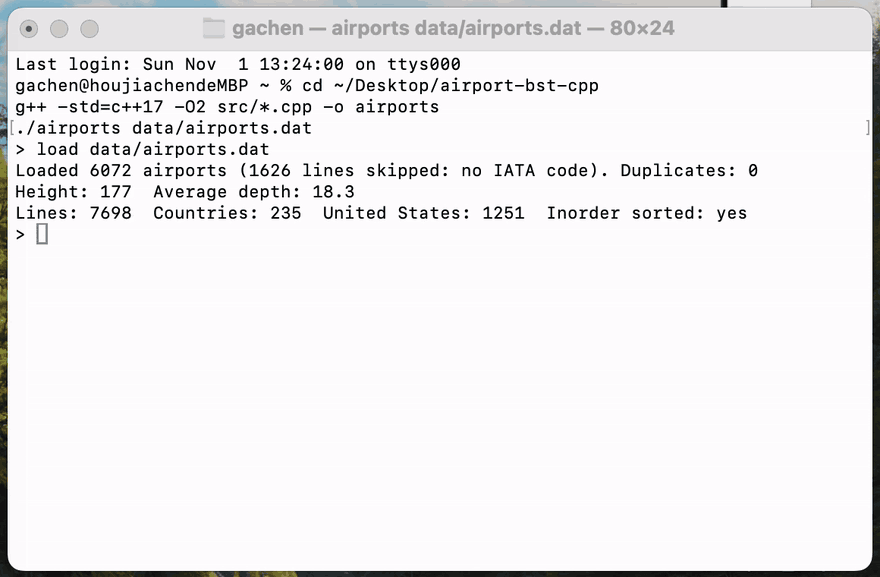

# Airport Code Lookup Service with a Binary Search Tree

A command-line lookup service for the world's airports, written in C++ on our own binary search
tree keyed by the three-letter IATA code. Given a code it returns the airport's name, city, country
and location, it stays correct while airports are added and removed, and it answers alphabetical
listings and range queries such as "every code from BOS to BWI".

EECE Mini Project · Northeastern University · Fall 2026 · Jiachen Hou

## The problem

Every flight booking, boarding pass and baggage tag identifies an airport by its IATA code
(BOS for Boston Logan, JFK for New York Kennedy, DAC for Dhaka). A travel company needs:

- a fast lookup from code to airport,
- insertion and deletion while the database changes,
- an alphabetical listing and range queries for customer agents.

A binary search tree gives all three: search, insert and delete in Θ(h), an inorder traversal that
is already sorted, and range queries that skip every subtree outside the range. The project also
shows how much the height h, and therefore the speed, depends on the order of insertion.

## Build and run

```
g++ -std=c++17 -O2 src/*.cpp -o airports
./airports data/airports.dat
```

The program reads commands from the keyboard (type `help`). It can also read a command file:

```
./airports < docs/demo_commands.txt
```

| Command | What it does |
|---|---|
| `load FILE` | load `airports.dat` and build the tree in file order, or reload a file written by `save` |
| `find CODE` | search; prints every code compared and the airport |
| `min`, `max` | smallest and largest code |
| `remove CODE` | delete an airport (leaf, one child, two children, root) and validate |
| `add CODE` | insert a new airport (asks for name, city and country) |
| `list [N]` | every airport in code order (inorder), or the first N; checks that the list is sorted |
| `save FILE` | write the codes in preorder |
| `validate` | check the BST property with the range (lo, hi) method |
| `range FROM TO [-q]` | airports with FROM ≤ code ≤ TO and the number of nodes visited (`-q`: count only) |
| `levels [K]` | level order of the top K levels (default 3) |
| `build file\|sorted\|shuffle [seed]` | rebuild the tree in another insertion order |
| `rebalance` | rebuild as a balanced tree (middle element as the root) |
| `stats` | size, root, height, average depth, min, max |
| `experiment` | the Task 6 shape experiment table |
| `test` | runs every required test case and prints PASS / FAIL |

## Sample session

The session from the project handout, with the full search paths
(the complete session is in [`docs/sample_session.txt`](docs/sample_session.txt)):

```
> load data/airports.dat
Loaded 6072 airports (1626 lines skipped: no IATA code). Duplicates: 0
Height: 177  Average depth: 18.3
Lines: 7698  Countries: 235  United States: 1251  Inorder sorted: yes
> find BOS
Path: GKA -> AEY -> EGS -> BUJ -> BJA -> BSK -> BOY -> BNI -> BOH -> BOO -> BOU -> BOS (comparisons: 12)
BOS  General Edward Lawrence Logan International Airport, Boston, United States
> find XYZ
Path: GKA -> MAG -> POM -> WWK -> YAM -> XFW -> XGN -> XLS -> XRY -> XVS -> YAI -> YAA -> XYA -> XYE -> (NULL) not found (comparisons: 14)
> range BOS BWI -q
113 airports, 127 nodes visited
> remove BOS
Deleted BOS (case D2: only a left child, BOR)  validate: OK
> remove AEY
Deleted AEY (case D3: two children; successor AFA copied in, successor removed with D2)  validate: OK
> rebalance
Height: 12  Average depth: 10.7
```

Every number matches the expected results in the handout: 6,072 airports, 1,626 skipped lines,
0 duplicates, height 177, average depth 18.3, 12 comparisons for BOS, 113 airports and 127 nodes
visited for BOS–BWI, BOS deleted with case D2 (left child BOR), and height 12 / depth 10.7 after
`rebalance`.

## Tests

`test` runs every case the project asks for on a fresh tree and checks the result:

- **Task 1:** 6,072 airports, 0 duplicates, 235 countries, 1,251 in the United States,
  height 177, `validate` after every one of the 6,072 inserts, sorted inorder list.
- **Task 2:** search for the root, a leaf, the deepest node, a missing code (XYZ), a code smaller
  than every key and one larger than every key; minimum and maximum.
- **Task 3:** delete a leaf (D1), a node with only a left child and one with only a right child (D2),
  a node with two children (D3), the root, and BOS; print the top three levels before and after
  each delete; validate after each. Add a made-up airport QQQ, find it, remove it.
- **Task 4:** sorted list, `save` in preorder, reload, and check that the reloaded tree has the same
  height and the same level order; validate.
- **Task 5:** `range BOS BWI` returns 113 airports, the same count as a full scan, while visiting
  only a small part of the tree.
- **Task 6:** `rebalance` gives height 12 and a valid tree.

Result: **28 passed, 0 failed** (full output in [`docs/test_output.txt`](docs/test_output.txt)).

## Task 6: the shape experiment

The same 6,072 codes inserted in four different orders, then 10,000 random successful searches
(the same codes for every tree; time is the best of 5 runs, from
[`docs/experiment_output.txt`](docs/experiment_output.txt)):

| Build order | Height | Average depth | Time for 10,000 searches | Explanation |
|---|---|---|---|---|
| File order | 177 | 18.3 | 2.16 ms | The file lists airports by ID, in blocks by country, and some blocks are already in alphabetical order. These sorted runs build long chains (see below). |
| Sorted order | 6,071 | 3,035.5 | 136.58 ms | Every new code is larger than all earlier ones, so it always goes right: the tree is a chain with h = n − 1 and a search is a linear scan. |
| Balanced (middle rule) | 12 | 10.7 | 1.72 ms | The middle element of every range becomes the root, so both subtrees have the same size and h = ⌊log₂ 6072⌋ = 12, the smallest possible. |
| Random shuffle (bonus, seed 2026) | 27 | 14.2 | 1.98 ms | A random order has no long sorted runs, so the height is a small multiple of log₂ n, close to the balanced tree. |

The average number of comparisons per search follows the average depth: 19.3 in file order,
3,043.9 in sorted order, 11.7 balanced and 15.2 shuffled. Every operation costs Θ(h), so the
sorted build is about 80 times slower to search than the balanced one, although it holds exactly
the same keys. Timings were measured on our development machine and will differ on other computers;
the heights, depths and comparison counts do not change.

### Why is the file order so much worse than a random shuffle?

Because the file is not random. `airports.dat` is ordered by airport ID, and the IDs were assigned
country by country, often from lists that were already alphabetical. The clearest case is lines
42 to 205: **162 Canadian airports whose codes are in increasing order, from YDA to ZFM** (almost
every Canadian code starts with Y). Inserting an increasing run makes each code the right child of
the previous one, exactly like the sorted build, so this one block alone adds a chain of more than
160 levels. The deepest node, YZR at depth 177, sits at the end of that chain:
`find YZR` walks GKA → MAG → POM → WWK → YAM → … through almost every Canadian Y code.
There are five more sorted runs of 21 to 35 codes in the file, in United States, Canadian and
Icelandic blocks.

A random shuffle breaks these runs apart, so no long chain can form and the height drops from 177
to about 25–29 (27 with our seed). This is why the insertion order matters so much: the same keys
give a height of 12, 27, 177 or 6,071 depending only on the order in which they arrive.

## Design

- **`Airport`** (`src/Airport.h`, `src/Airport.cpp`) — one record: IATA, name, city, country, ICAO,
  latitude, longitude. `splitCsvLine` handles commas inside quoted names (for example
  `"Harstad/Narvik Airport, Evenes"`) and doubled quotes (`"Magdeburg ""City"" Airport"`).
  Lines whose IATA code is `\N` are skipped.
- **`AirportBST`** (`src/AirportBST.h`, `src/AirportBST.cpp`) — the tree, with a private `root`.
  Insert, search, delete and every traversal (inorder, preorder, level order, validate, range,
  clear) use loops and an explicit stack or queue instead of recursion, so the sorted build
  (a chain of 6,072 nodes) cannot overflow the call stack. Only the balanced build is recursive,
  and its depth is about 13.
- **`main.cpp`** — the command interpreter, the loader, our own merge sort and binary search, the
  Task 6 experiment and the test suite.

The pseudocode for build, insert, search, delete, validate, range and the balanced build, with the
cost of each operation, is in [`docs/pseudocode.md`](docs/pseudocode.md).

## Repository layout

```
src/        Airport.h/.cpp, AirportBST.h/.cpp, main.cpp
data/       airports.dat (OpenFlights, course copy)
docs/       pseudocode.md, demo_commands.txt, sample_session.txt,
            test_output.txt, experiment_output.txt, demo.gif
```

## Demo



## Progress

- [x] M1 — Data and build: loader, `Airport` and `AirportBST`, insert, height; 6,072 airports, 0 duplicates, inorder sorted
- [x] M2 — Search and delete: find with path, min/max, remove (all cases), add; validate after each
- [x] M3 — Traversals and queries: list, save/load in preorder, range; reloaded tree has the same shape; range BOS BWI returns 113
- [x] M4 — Experiment and publish: Task 6 table and explanation, README, demo

## Data credit

Airport data: **OpenFlights.org** — [openflights.org/data.php](https://openflights.org/data.php),
GitHub repository [jpatokal/openflights](https://github.com/jpatokal/openflights), file
`airports.dat`, using the copy posted on the course page. The data is published under the
[Open Database License](https://opendatacommons.org/licenses/odbl/1-0/).

## AI use

Claude (Anthropic, Claude Opus 5.5) was used to help draft the code, the pseudocode and this README,
in line with the course AI-use policy. I reviewed, ran and tested all of the code and can explain
every part of it.
